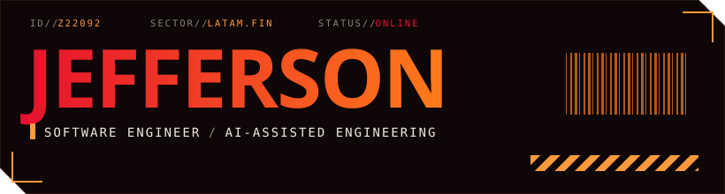
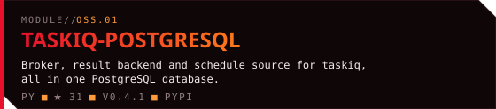

  

Hi, I'm Jefferson, a software engineer at a large crypto exchange and payment institution in Latin America. I build the backend of its financial products, mostly distributed systems in Python.

I also drive AI-assisted engineering there. I built our internal harness for Claude Code, with agents for code review, incident investigation and architecture docs, and onboarded every engineering team onto it.

In open source, I maintain [taskiq-postgresql](https://github.com/z22092/taskiq-postgresql).

Python · FastAPI · async SQLAlchemy · PostgreSQL · RabbitMQ · Redis · Kubernetes 
Won our first internal hackathon (2025) and an internal AI award (2026).

<samp>$ <a href="https://www.linkedin.com/in/jeffvenceslau">linkedin</a> · <a href="https://pypi.org/project/taskiq-postgresql/">pypi</a></samp>
